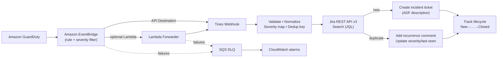
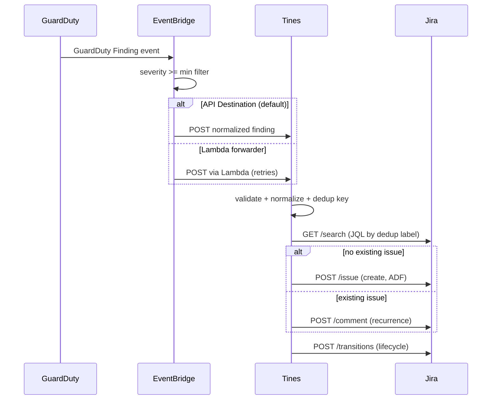
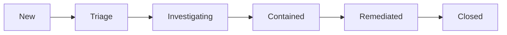

# AWS GuardDuty → Tines → Jira Incident Response

```text
 ╔════════════════════════════════════════════════════════════════╗
 ║  Event-driven AWS security monitoring • SOAR automation • IaC  ║
 ╚════════════════════════════════════════════════════════════════╝
```


An automated security incident-response workflow that receives **Amazon GuardDuty**
findings through **Amazon EventBridge**, forwards them to **Tines**, enriches and
deduplicates them, and creates or updates a **Jira Cloud** incident ticket — then
tracks the incident through its response lifecycle.

> ⚠️ **Educational portfolio project.** Review and harden before any production use.
> Automated destructive containment is **intentionally disabled**; the workflow
> creates and tracks tickets only. See the [Disclaimer](#disclaimer).

## Business problem

SOC teams are flooded with repeated GuardDuty findings. Without automation, the
same finding is re-triaged, tickets are duplicated, and severity increases are
missed. This project demonstrates a complete event-driven SOAR pipeline that:

- Detects and routes GuardDuty findings at or above a configurable severity.
- Normalizes, enriches and **deduplicates** findings.
- Creates a single, well-structured Jira incident per finding.
- Adds recurrence comments and updates severity when findings recur.
- Provides observability (logs, alarms, dead-letter queue) and resilience (retries, DLQ).

## Key features

- **AWS security monitoring** — GuardDuty detector with S3, Kubernetes and Malware Protection sources.
- **Event-driven architecture** — EventBridge rule with configurable minimum-severity filtering.
- **SOAR automation** — Tines Story (19 actions) with credential placeholders.
- **Incident-response workflow** — Jira create/search/comment/transition with dedup.
- **REST API integration** — Jira Cloud REST API v3 with valid Atlassian Document Format (ADF).
- **Infrastructure as Code** — Terraform (fmt/init/validate green), least-privilege IAM.
- **Python automation** — typed, modular, stdlib-only, fully tested.
- **Secure secret management** — Secrets Manager / SSM references; no secrets in code or state.
- **Observability** — CloudWatch logs + alarms + SQS DLQ.
- **Resilience** — retry/backoff/Retry-After, dead-letter queue, malformed-event handling.
- **Testing** — 106 tests, 87.9% coverage; ruff/black/mypy clean.
- **DevSecOps-ready** — CI/CD workflows and quality files (added in a later phase).

## Architecture



A full set of diagrams (event processing sequence, dedup flow, error handling,
incident lifecycle) lives in [docs/architecture.md](docs/architecture.md).

## Event flow



## Technology stack

| Layer | Technology |
|---|---|
| Detection | Amazon GuardDuty |
| Event routing | Amazon EventBridge (rule, API Destination, Connection) |
| SOAR | Tines (Webhook + HTTP Request actions) |
| Ticketing | Jira Cloud REST API v3 (ADF) |
| Compute (optional) | AWS Lambda (Python 3.12, stdlib only) |
| IaC | Terraform (AWS provider ~> 5.0) |
| Secrets | AWS Secrets Manager + SSM Parameter Store |
| Observability | Amazon CloudWatch Logs + Alarms + SQS DLQ |
| Automation code | Python 3.11+ (typed, stdlib only) |
| Tests | pytest, pytest-cov, ruff, black, mypy |

## Repository structure

```text
.
├── src/
│   ├── incident_response/        # core library (validation, normalizer, jira ADF, http, masking, logging)
│   └── lambda_forwarder/         # optional Lambda target
├── tools/simulate_finding.py     # CLI simulator (dry-run by default)
├── local_emulator/               # Tines-independent fallback (stdlib HTTP + mock Jira)
├── examples/                     # 12 sanitized GuardDuty event files
├── tests/                        # pytest suite (106 tests)
├── terraform/                    # IaC (GuardDuty, EventBridge, IAM, SQS, monitoring, lambda, secrets)
├── tines/                        # importable Tines Story template (JSON)
├── docs/                         # architecture, setup, schema, playbooks, threat model, etc.
├── pyproject.toml
├── Makefile                      # (added in CI/quality phase)
└── README.md
```

## Prerequisites

- Python 3.11+
- Terraform >= 1.5
- An AWS account (for deployment only; the demo needs none)
- A Tines tenant and a Jira Cloud site (only for live integration; the demo uses the local emulator)

## AWS costs (warning)

- GuardDuty is priced per monitored resource (EC2/EBS, S3, Kubernetes, etc.).
- EventBridge, SQS, CloudWatch Logs and Secrets Manager incur small per-call/GB fees.
- **A few dollars per day** is realistic for a non-trivial account; costs grow with workload.
- Use `guardduty_min_severity` to reduce volume, and run `terraform destroy` when done.
- See https://aws.amazon.com/guardduty/pricing/ for current pricing (subject to change).

## Quick start (demo, no AWS/Tines/Jira required)

```powershell
python -m pip install -e ".[dev]"
python -m tools.simulate_finding --input examples/guardduty-high-severity.json --dry-run
```

Start the local emulator and send a sanitized finding:

```powershell
python -m local_emulator.server   # serves on 127.0.0.1:8080
# in another shell:
curl -X POST http://127.0.0.1:8080/webhook `
  -H "Content-Type: application/json" `
  --data @examples/guardduty-high-severity.json
```

See [docs/demo-guide.md](docs/demo-guide.md) for the full safe demo.

## AWS deployment

1. Configure AWS credentials.
2. `cd terraform`
3. `cp terraform.tfvars.example terraform.tfvars` and edit (set Tines webhook URL, etc.).
4. Set Secrets Manager values out-of-band (never in tfvars).
5. `terraform init && terraform plan && terraform apply`

See [docs/setup-aws.md](docs/setup-aws.md).

## Tines setup

Import the Story and create the four credentials. See [docs/setup-tines.md](docs/setup-tines.md).

## Jira setup

Create a Jira API token and configure priority mapping. See [docs/setup-jira.md](docs/setup-jira.md).

## Testing

```powershell
python -m pytest
python -m pytest --cov=src/incident_response --cov=src/lambda_forwarder --cov=tools --cov=local_emulator --cov-report=term-missing --cov-fail-under=85
ruff check .
black --check .
mypy src tools local_emulator
```

Results: **106 passed, 87.9% coverage, ruff/black/mypy clean.**

## Example GuardDuty event

See `examples/guardduty-high-severity.json` (sanitized: account `111122223333`,
documentation IP ranges only). See [docs/event-schema.md](docs/event-schema.md).

## Example Jira ticket

Summary: `[GuardDuty][High][111122223333][us-east-1] Trojan Dropper detected on EC2 instance.`
See [docs/jira-ticket-schema.md](docs/jira-ticket-schema.md).

## Deduplication behavior

Repeated findings share a stable `gd-<16hex>` label; a recurrence comment is added
instead of a duplicate ticket. See [docs/deduplication.md](docs/deduplication.md).

## Failure handling

- HTTP retries on timeout/408/429 (honouring `Retry-After`)/5xx; no retry on other 4xx.
- Undeliverable events go to the SQS DLQ; CloudWatch alarms alert on DLQ depth and failed invocations.
- Malformed/unauthenticated events are rejected without secrets in logs.
- See [docs/architecture.md](docs/architecture.md) (error-handling flow) and [docs/troubleshooting.md](docs/troubleshooting.md).

## Monitoring

CloudWatch log group, DLQ-depth alarm, EventBridge FailedInvocations alarm, Lambda
Errors alarm. See [docs/monitoring.md](docs/monitoring.md).

## Security controls

- Least-privilege IAM (EventBridge, Lambda).
- Secrets Manager secrets created without versions (values never in Terraform state).
- Recursive secret masking in logs; webhook URLs sanitized.
- Webhook shared-secret authentication.
- Input validation and payload-size limits.
- See [docs/threat-model.md](docs/threat-model.md) (STRIDE) and [SECURITY.md](SECURITY.md) (added in CI/quality phase).

## Incident-response lifecycle



Playbooks (IAM key, EC2, crypto, S3, malware, Kubernetes) are in
[docs/incident-response-playbooks.md](docs/incident-response-playbooks.md).
Automated destructive containment is intentionally disabled.

## Cleanup

```powershell
cd terraform
terraform destroy
```

Remove the Tines Story/credentials and rotate/delete the Jira API token.

## Troubleshooting

See [docs/troubleshooting.md](docs/troubleshooting.md).

## Known limitations

- The API Destination path stores the Tines webhook URL in EventBridge config; use the Lambda path + Secrets Manager to avoid this.
- Jira transition IDs and priority names are site-specific.
- The Tines Story is a template; Liquid expressions must be validated in a real Tines tenant.
- No automated destructive remediation by design.

## Future improvements

- Run-time secret resolution in the Lambda (fetch webhook URL/secret from Secrets Manager).
- Bidirectional Jira status sync back to a tracking dashboard.
- Auto-suppression of low-severity noise after N recurrence.
- Multi-account GuardDuty aggregator support.

## What this project demonstrates

AWS security monitoring, event-driven architecture, SOAR automation, incident-response
workflow, REST API integration, Infrastructure as Code, Python automation, secure
secret management, observability, resilience, testing, and DevSecOps readiness.

## Design decisions

- EventBridge sits between GuardDuty and Tines (GuardDuty does not POST to arbitrary URLs).
- API Destination is the preferred target; Lambda is optional for custom signing/retry/secrets.
- Deduplication uses a stable hash of the finding id stored as a Jira label.
- ADF is used for Jira rich text (REST API v3 requirement).
- Secrets are referenced, never embedded; Secrets Manager secrets are created empty.

## Trade-offs

- Simplicity over over-engineering: stdlib-only Python, no heavy runtime deps.
- Tines Story is a template, not executed here; validated as JSON only.
- `terraform plan`/`apply` require live AWS credentials (not run in this repo's validation).

## Interview discussion points

See [docs/interview-talking-points.md](docs/interview-talking-points.md).

## Screenshots

See [docs/screenshots.md](docs/screenshots.md) (placeholders).

## Disclaimer

This project is educational and demonstrates architecture and engineering practices.
GuardDuty findings are generated and delivered through AWS services. Tines and Jira
may require separate accounts or licenses; free-tier availability and pricing can
change. Use sanitized sample findings for demonstration. Review and harden before
production use. Automated destructive containment is intentionally disabled.
