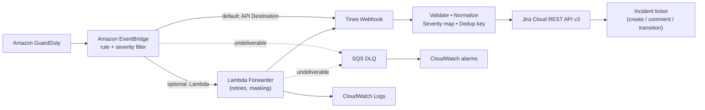
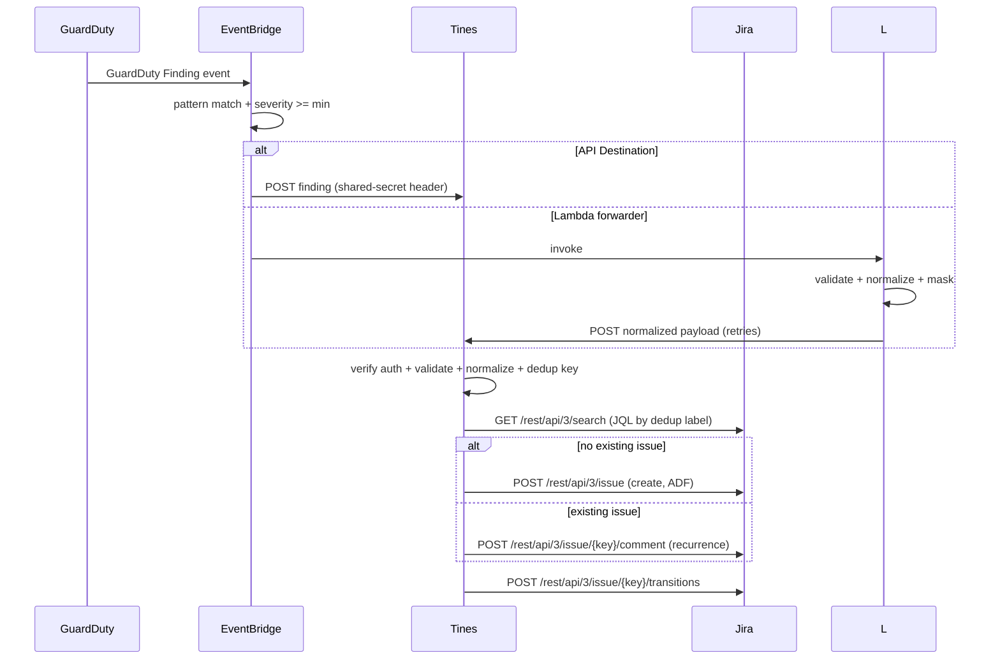
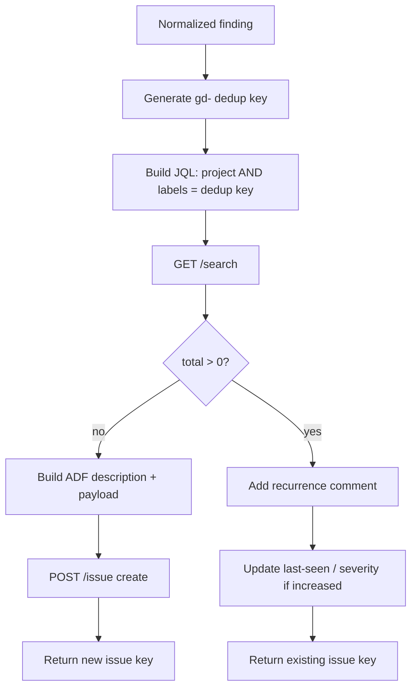
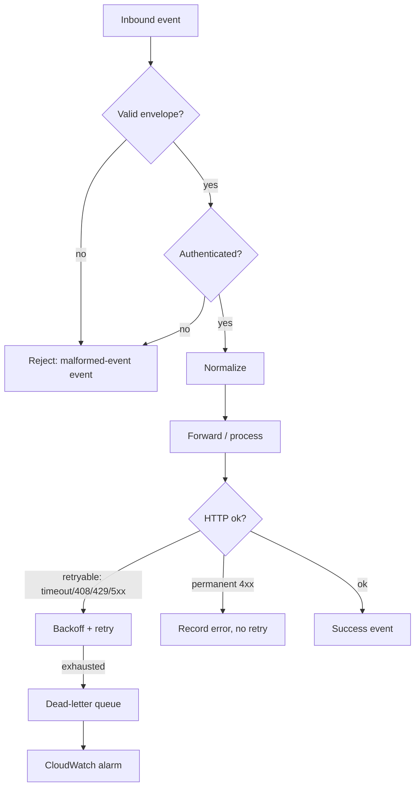
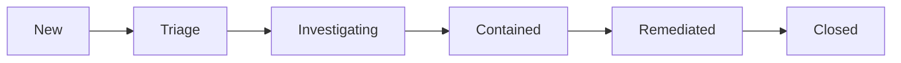

# Architecture

This document contains the Mermaid diagrams for the system. All diagrams are
written to render correctly on GitHub.

## High-level architecture

## Event processing sequence

## Jira deduplication flow

## Error-handling flow

## Incident lifecycle

