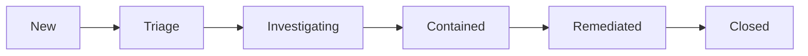

# Incident Response Playbooks

Suggested playbooks for the finding types this workflow handles. **Automated
destructive containment is intentionally disabled** — every containment step
requires human approval.

## Lifecycle

Suggested Jira transitions (IDs are project-specific; retrieve via
`GET /rest/api/3/issue/{key}/transitions`): New → Triage → Investigating →
Contained → Remediated → Closed.

## Common playbook structure

Each playbook follows: **Validation → Evidence collection → Containment →
Eradication → Recovery → Post-incident review**, with explicit human-approval
gates before destructive actions.

---

## 1. Compromised IAM access key

- **Validation**: Confirm the finding (`UnauthorizedAccess:IAMUser/*`,
  `CredentialAccess:*`). Identify the principal and access key id from
  `resource.accessKeyDetails`.
- **Evidence**: Review CloudTrail for anomalous API calls around `last_seen`.
  Capture the API call list and source IPs.
- **Containment (human approval required)**: Deactivate or rotate the access key.
  Revoke active sessions.
- **Eradication**: Review and tighten IAM policies attached to the principal.
  Remove unused permissions.
- **Recovery**: Issue a new key via approved process; update consumers.
- **Post-incident**: Document root cause; add guardrails (e.g. IP conditions,
  MFA).
- **Human approval**: Do NOT deactivate the key before evidence is captured.

## 2. Suspicious EC2 activity

- **Validation**: Confirm finding type (`Trojan:EC2/*`, `Recon:EC2/*`). Identify
  the instance from `resource.instanceDetails`.
- **Evidence**: Capture VPC flow logs, EBS snapshots, and process evidence.
- **Containment (human approval required)**: Move the instance to a quarantine
  security group; restrict egress.
- **Eradication**: Identify and remove the malicious process/artifact.
- **Recovery**: Rebuild from a known-good AMI; restore data from clean backups.
- **Post-incident**: Harden the AMI/launch template; review ingress rules.
- **Human approval**: Do NOT terminate before snapshots/evidence are captured.

## 3. Cryptocurrency mining

- **Validation**: Confirm `CryptoCurrency:EC2/*`. Identify the instance.
- **Evidence**: VPC flow logs for mining pools (e.g. port 3333); CPU metrics.
- **Containment (human approval required)**: Isolate the instance (quarantine
  security group).
- **Eradication**: Terminate the instance after evidence capture; revoke
  temporary credentials (e.g. instance role abuse).
- **Recovery**: Rebuild from clean AMI; review auto-scaling / launch templates.
- **Post-incident**: Add cost/billing anomaly alerts; restrict instance roles.
- **Human approval**: Termination and credential revocation require approval.

## 4. S3 data-access anomaly

- **Validation**: Confirm `UnauthorizedAccess:S3/*` or
  `DefenseEvasion:S3/*`. Identify the bucket from `resource.s3BucketDetails`.
- **Evidence**: S3 server access logs; CloudTrail `GetObject`/`PutObject` calls.
- **Containment (human approval required)**: Tighten bucket policy; block public
  access; revoke suspect credentials.
- **Eradication**: Remove unauthorized objects; rotate compromised credentials.
- **Recovery**: Restore affected objects from versioning/backups.
- **Post-incident**: Enable S3 access logging; add data-classification controls.
- **Human approval**: Bucket policy changes and credential revocation require approval.

## 5. Malware finding

- **Validation**: Confirm `Malware:EC2/MaliciousFile`. Identify the instance and
  scan id from `resource.malwareScanDetails`.
- **Evidence**: GuardDuty Malware Protection scan result; affected file path/hash.
- **Containment (human approval required)**: Isolate the instance.
- **Eradication**: Remove the malicious file; if widespread, rebuild the host.
- **Recovery**: Restore from clean backup; re-scan.
- **Post-incident**: Update endpoint controls; review how the file arrived.
- **Human approval**: Isolation and rebuild require approval.

## 6. Kubernetes suspicious activity

- **Validation**: Confirm `UnauthorizedAccess:Kubernetes/*` or
  `CredentialAccess:Kubernetes/*`. Identify the cluster from
  `resource.kubernetesDetails`.
- **Evidence**: Kubernetes audit logs; identify the user/UA/source IP from
  `service.action.kubernetesApiCallAction`.
- **Containment (human approval required)**: Revoke the suspect service account
  token / credential; restrict API server access.
- **Eradication**: Remove malicious workloads/roles; audit RBAC.
- **Recovery**: Re-issue credentials via approved process.
- **Post-incident**: Add API server network restrictions; enable audit logging.
- **Human approval**: Credential revocation and RBAC changes require approval.

## Conditions requiring human approval

- Disabling/rotating IAM credentials.
- Isolating or terminating EC2 instances.
- Changing S3 bucket policies or revoking credentials.
- Rebuilding hosts from AMI.
- Revoking Kubernetes credentials or changing RBAC.

None of these are performed automatically by the default implementation.
